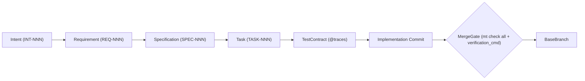

# multi-tasker (`mt`)

Deterministic multilevel agent `Policy` enforcement, bidirectional `Traceability`, and isolated Git `Worktree` `Orchestrator` CLI.



## 1. Installation & Bootstrapping

```bash
# Install multi-tasker (or pip install -e ".[dev]" from a local checkout)
pip install git+https://github.com/philipp-vocal-logic/multi-tasker.git

# Scaffold policy/*.yaml, artifacts/**, .gitignore, AGENTS.md, and .report/specification.md
mt initialize --preset python --root /path/to/repo   # presets: python, ansi-c, rust
```

When bootstrapping a new repository, follow the generated `AGENTS.md` in your target repository root to customize `policy/*.yaml` and commit your initial `INT-001` baseline before running `mt check all` or `mt run`.

## 2. Getting Help & Live Documentation from `mt`

Never rely on static copies of policies, schemas, or role instructions—query `mt` directly so output always reflects live `policy/*.yaml` and `artifacts/**` state:

```bash
# List all CLI subcommands and top-level usage
mt --help

# Inspect flags and arguments for any specific subcommand (e.g., check, run, initialize, resolve)
mt <subcommand> --help

# Generate and print the live repository Specification and Mermaid diagrams (.report/specification.md)
mt documentation

# Synthesize the self-contained prompt and active policy limits for an agent role
mt prompt <agent-role> [--target <id>]

# Run all deterministic policy validators (exits 0 with empty stdout on pass)
mt check all
```

## 3. Single Sources of Truth

- **[AGENTS.md](AGENTS.md)**: Development principles, layer boundaries, and the mandatory `INT` -> `REQ` -> `SPEC` -> `TASK` -> `mt run` dogfooding workflow.
- **`policy/*.yaml` & `artifacts/**`**: Sole authoritative configuration and artifact lineage.
- **`.report/specification.md`**: Live repository `Specification` generated by `mt documentation` (gitignored).
- **`.report/logs/events.jsonl` & `.report/logs/tasks/<TARGET-ID>.jsonl`**: Runtime CLI, `Worktree`, and `MergeGate` telemetry logs (gitignored).
