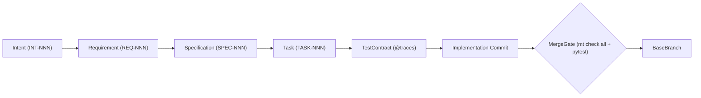

# multi-tasker (`mt`)

Deterministic multilevel agent `Policy` enforcement, bidirectional `Traceability`, and isolated Git `Worktree` `Orchestrator` CLI.

`multi-tasker` enforces a canonical software engineering pipeline where every stage and `Task` executes in an isolated `Worktree` and must pass a deterministic `MergeGate` before merging onto the `BaseBranch`:



---

## 1. Bootstrapping a Separate Repository

### Step 1: Install `multi-tasker` as a Library
Install `multi-tasker` into your target repository's Python virtual environment so the `mt` CLI is on `PATH` and `multi_tasker` is importable:

```bash
pip install git+https://github.com/philipp-vocal-logic/multi-tasker.git
# Or from a local checkout:
pip install -e /path/to/multi-tasker
```

Or declare it in your target repository's `pyproject.toml`:

```toml
[project.optional-dependencies]
dev = [
    "multi-tasker @ git+https://github.com/philipp-vocal-logic/multi-tasker.git",
    "pytest>=8.0",
    "ruff>=0.4",
    "mypy>=1.10",
]
```

### Step 2: Initialize the Target Repository
Run `mt initialize` targeting your repository root:

```bash
mt initialize --root /path/to/target-repo
```

`mt initialize` scaffolds:
- `policy/*.yaml` — Default `Policy` files (created only if missing; existing files are never overwritten).
- `artifacts/{intents,requirements,specifications,tasks,escalations,decisions,reviews}/` — Canonical artifact directories.
- `.gitignore` — Ensures `.worktrees/`, `.report/`, and `.mt_prompt.md` are ignored by Git.
- `AGENTS.md` — External project agent instructions covering bootstrapping, `Policy` customization, and the canonical `mt` lifecycle.
- `.report/specification.md` — Generated live repository `Specification` and Mermaid diagrams.

### Step 3: Tailor `policy/*.yaml` for Your Project's Use Case
Before creating your first baseline commit, customize the scaffolded `policy/*.yaml` files for your system:

1. **`policy/architecture.yaml` (Must Customize)**:
   - Replace `layers` (`name`, `paths`, `allowed_internal_imports`, `forbidden_internal_imports`) to match your repository's package and folder structure (e.g., `src/domain/**`, `src/services/**`, `app/core/**`, `tests/**`).
   - Add your project's external libraries to `allowed_third_party_packages` while keeping `"multi_tasker"` and `"pytest"`.
2. **`policy/glossary.yaml` (Must Customize)**:
   - Keep Sections 1–3 (core `mt` artifacts, actor roles, and enforcement vocabulary required for role prompt synthesis).
   - Add your project's domain terms, `code_identifiers` casing, and `forbidden_synonyms`.
3. **`policy/pipeline.yaml` & `policy/permissions.yaml` (Workflow & Execution Tuning)**:
   - Configure each stage's `approval_gate` (`"human"`, `"review-agent"`, or `"auto"`), `execution_bounds`, and `escalation_routes` in `policy/pipeline.yaml`.
   - Configure `execution_environments` (`default_environment`, `default_model`, `default_context_mode`: `"inline"` or `"paths"`), per-role `agents.<role>.model`, and `worker-agent` `task_type_path_constraints` in `policy/permissions.yaml`.
4. **`policy/clean_code.yaml`, `policy/limits.yaml`, `policy/schemas.yaml`, `policy/traceability.yaml` (Engineering Constraints)**:
   - Tune `ast_rules` (such as `forbid_print_in_src` or `allowed_single_char_names`), linter flags, source code sizing bounds, and `target_files` path patterns.
   - Toggle boolean flags or adjust values rather than deleting required `Policy` keys.

### Step 4: Seed `INT-001` and Commit the Baseline Configuration
Uncommitted modifications to `policy/**` trigger `[PERM_POLICY_MODIFIED]` during `mt check permissions`, and `policy/` is mounted read-only inside agent `Worktrees`. Additionally, `mt check traceability` verifies that every Git commit subject matches the traceable commit pattern.

Create an initial `Intent` and commit the bootstrapped repository on `BaseBranch`:

```bash
cd /path/to/target-repo
mt intent "Bootstrap repository and configure project policies"
git add .
git commit -m "INT-001: Bootstrap repository and configure project policies [traces: INT-001]"
mt check all
```

`mt check all` will exit with code `0` and empty `stdout`.

---

## 2. Canonical Development Workflow

Never edit `src/**`, `tests/**`, `policy/**`, or completed (`done`) `TASK-NNN.md` files ad-hoc on `BaseBranch`. Progress every change through the canonical pipeline:

1. **Intent (`INT-NNN`)**:
   ```bash
   mt intent "<feature or bugfix goal>"
   ```
   Creates an `open` `Intent` in `artifacts/intents/INT-NNN.md`.
2. **Requirement (`REQ-NNN`)**:
   Author `artifacts/requirements/REQ-NNN.md` (`status: draft`, `traces_to: [INT-NNN]`) with testable `AcceptanceCriteria` (`AC-XX`) and `ImpactAnalysis`, then approve:
   ```bash
   mt approve REQ-NNN
   ```
3. **Specification (`SPEC-NNN`)**:
   Author `artifacts/specifications/SPEC-NNN.md` (`status: draft`, `traces_to: [REQ-NNN]`), covering all `REQ-NNN:AC-XX` criteria and declaring `target_files.tests` and `target_files.implementation`, then approve:
   ```bash
   mt approve SPEC-NNN
   ```
4. **Tasks (`TASK-NNN`) & `TestContracts`**:
   - Author a `type: test_contract` `Task` (`write_files` under `tests/**`) that decorates test functions with `@traces`:
     ```python
     from multi_tasker.domain.models import traces


     @traces("REQ-001", "AC-01", "SPEC-001")
     def test_feature_behavior() -> None:
         ...
     ```
   - Author `type: implementation` `Tasks` (`depends_on` the `test_contract` `Task`, `write_files` under `src/**`).
   - Commit the approved upstream artifacts and planned `Task` files on `BaseBranch` with a traceable commit subject (`SPEC-NNN: ... [traces: ...]`).
5. **Isolated Execution (`mt run`)**:
   - Execute scheduled `Tasks` in parallel waves across isolated `Worktrees`:
     ```bash
     mt run --max-workers 2
     ```
   - Execute a single scoped agent stage (`requirement-agent`, `specification-agent`, `planner-agent`, `worker-agent`, `review-agent`):
     ```bash
     mt run --agent requirement-agent --target INT-001
     ```
   - Or step through the declarative pipeline governed by `policy/pipeline.yaml`:
     ```bash
     mt run --pipeline
     ```

---

## 3. CLI Reference & Diagnostics

| Subcommand | Description |
| :--- | :--- |
| `mt initialize [--root <dir>]` | Scaffold `policy/*.yaml`, `artifacts/**`, `.gitignore`, `AGENTS.md`, and `.report/specification.md`. |
| `mt intent "<text-or-filepath>"` | Create the next sequential `INT-NNN.md` artifact in `artifacts/intents/`. |
| `mt approve <REQ\|SPEC\|DEC-ID>` | Validate and transition an artifact to `approved` and mark downstream artifacts `needs_update`. |
| `mt check [all\|permissions\|schemas\|clean_code\|limits\|glossary\|architecture\|traceability]` | Run deterministic `Policy` validators; exits `0` with empty `stdout` on pass or `1` with single-line `Findings`. |
| `mt schedule` | Output the next conflict-free parallel batch of eligible `TASK-NNN` IDs with disjoint `WriteScopes`. |
| `mt impact <REQ\|DEC-ID>` | List downstream `SPEC` and `TASK` IDs impacted by an upstream change. |
| `mt run [--pipeline] [--agent <role> --target <id>] [--max-workers <n>]` | Execute `Tasks`, single agent stages, or the declarative pipeline in isolated `Worktrees` via the `MergeGate`. |
| `mt resolve <ESC-ID> --by <DEC\|TASK-ID>` | Resolve an `Escalation` via an approved `Decision` or rescoped `Task` and propagate dirty flags. |
| `mt trace <ID-or-filepath>` | Inspect bidirectional `Traceability` across artifacts, `@traces` tests, and Git commits. |
| `mt prompt <agent-role> [--target <id>] [--context-mode inline\|paths]` | Synthesize the deterministic system and task prompt for an agent role from live repository state. |
| `mt documentation` | Regenerate and print `.report/specification.md` from live `policy/*.yaml` and `artifacts/**`. |

### Live Specification vs. Interaction Logs
- **`.report/specification.md`**: Deterministically generated live repository `Specification` and Mermaid architecture/state/lineage diagrams (gitignored).
- **`.report/logs/events.jsonl` & `.report/logs/tasks/<TARGET-ID>.jsonl`**: Structured JSONL telemetry recording every CLI invocation, in-`Worktree` agent subprocess execution, and `MergeGate` verification outcome.
